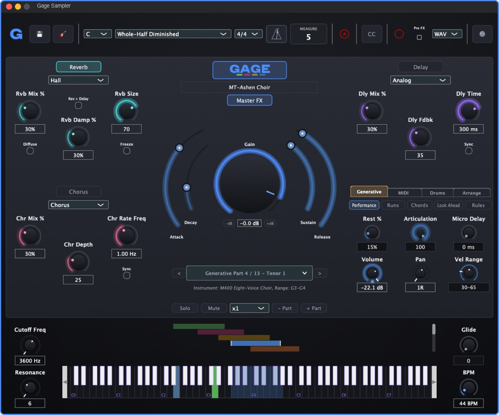
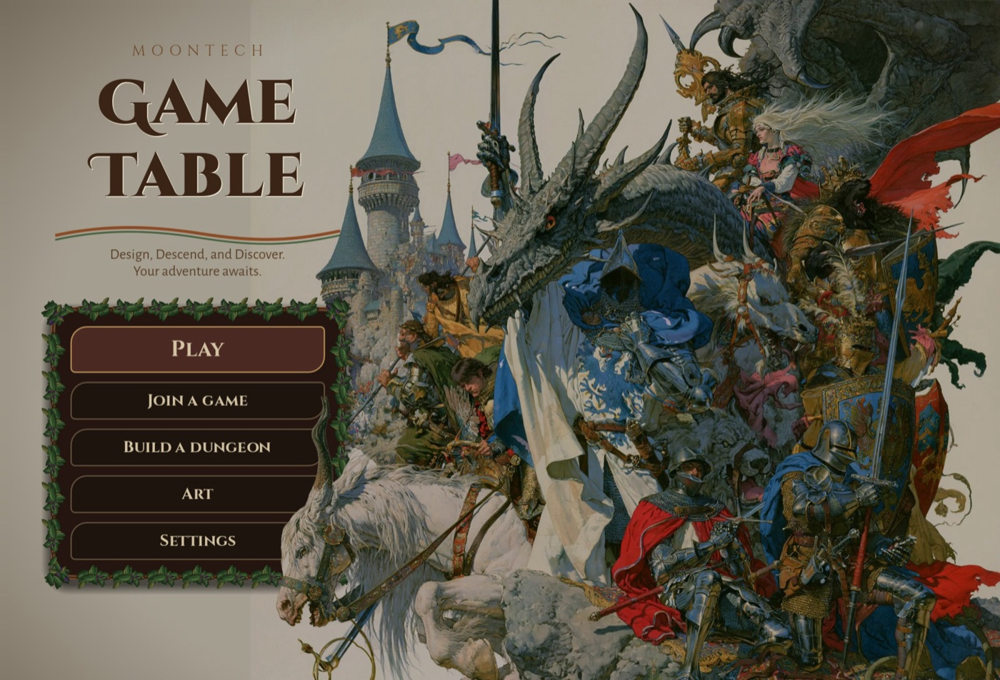
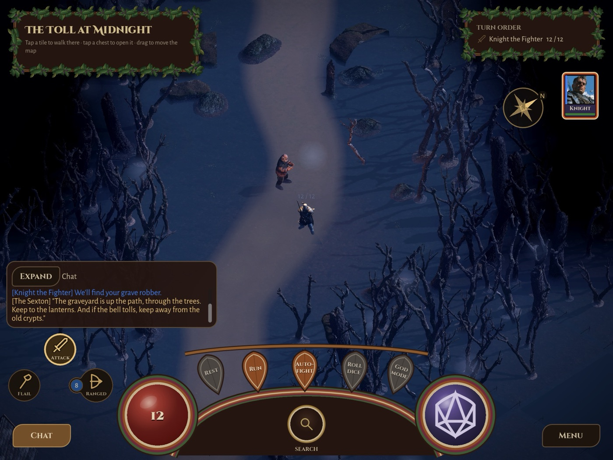
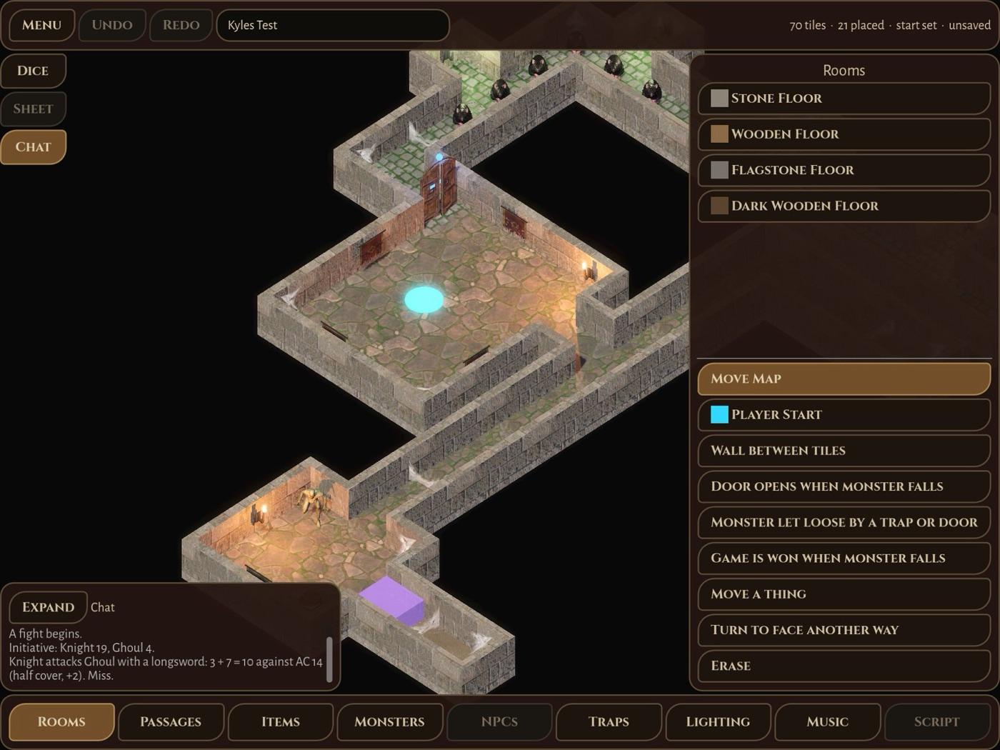

### Hi, I'm Kyle

I'm a musician, mix engineer and game audio director in Los Angeles. I also write software: music tools at Style Audio and a game at MoonTech Studios. The code for these projects is in private repositories, so this page describes what is in them.

---

## GAGE: a generative music engine

GAGE Sampler is a multi-sampling instrument paired with a generative engine that composes and plays its own music from a saved template. It runs as a standalone app and a VST3/AU plug-in on Mac and Windows. GAGE Player plays the same templates on iOS, and GAGE Core is the engine as a library for games.

- C++ with JUCE, Swift and SwiftUI for the iOS player, and a PHP and SQLite licence server
- A real-time audio engine with a weighted-random music generator (look-ahead, chord modes, key and scale arrangement)
- GAGE Core for Godot (GDExtension), a C API for other game engines, and OSC control from games
- Signed and notarized installers for macOS and Windows built with GitHub Actions, signed licence files, and an in-app instrument store
- An automated test suite

GAGE Sampler 1.1.0 is available at [style-audio.com](https://style-audio.com/).

---

## MoonTech Game Table: a fantasy role-playing game (in development)

MoonTech Game Table (MTGT) is a 3D fantasy role-playing game with a dungeon building kit, made in Godot 4 for iPad, Mac and PC. The game runs tabletop rules, with or without a live Dungeon Master, and each player can throw their own dice or fight in real time.

- About 65,000 lines of GDScript, Python and Swift tools for the art and voice pipelines, and over 640 automated tests
- Real-time six-second rounds, with players who roll their own dice in the same fight
- Play across devices through a relay server on Cloudflare Workers or over local Wi-Fi, with lockstep orders
- A Dungeon Master mode that sees the whole map and can rebuild anything the players haven't reached
- A level builder, a character creator, barter trading, voiced dialogue, and live music from GAGE Core
- Builds for iPad (TestFlight), Mac (notarized) and Windows

 

Captures from a development build. Some art is licensed stand-in work; its creators are credited at [moontechstudios.com/mtgt-credits.html](https://moontechstudios.com/mtgt-credits.html).

---

## MoonTech MIDI Editor: free, in the browser

A piano-roll MIDI editor in a single HTML file. It opens and saves Standard MIDI Files, highlights the key and scale, and has Pro Tools-style keyboard editing, quantize and a velocity pencil. It needs no install, works offline, and uses [@tonejs/midi](https://github.com/Tonejs/Midi) to read and write the files. It's free at [moontechstudios.com/midi-editor](https://moontechstudios.com/midi-editor/).

---

## Also

- The websites for [moontechstudios.com](https://moontechstudios.com/) and [style-audio.com](https://style-audio.com/), built with Python static site builders and their own deploy scripts

I'd be happy to walk through any of this code. You can reach me through [moontechstudios.com](https://moontechstudios.com/about.html).
